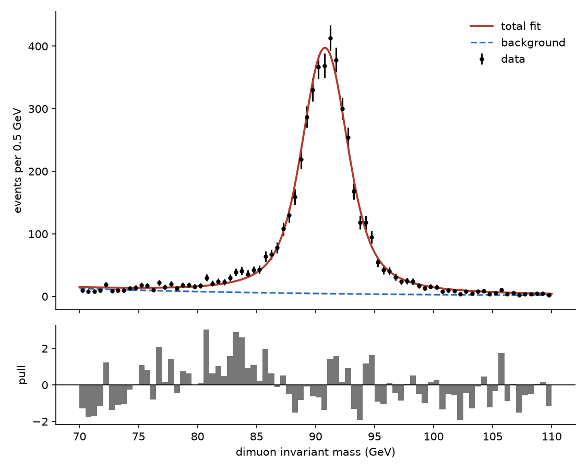
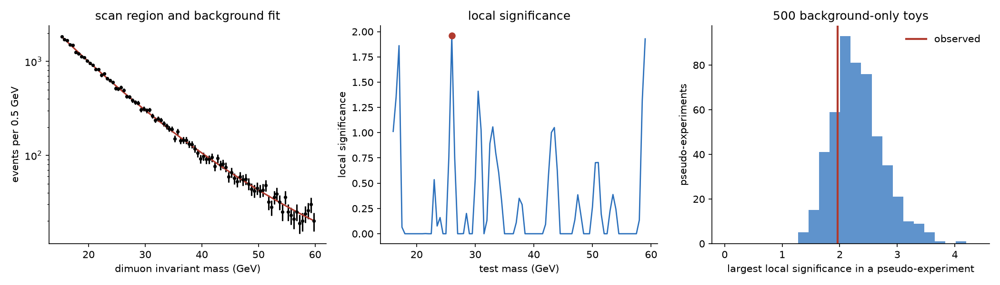

# Z boson mass from CMS open dimuon data

I fit the Z boson mass in 5064 selected dimuon events from public CMS data with an unbinned likelihood, and compare it with the Particle Data Group value, with a statistical and an indicative systematic uncertainty. I also scan the 15 to 60 GeV region for a bump and turn the largest local fluctuation into a global significance by running the same scan on pseudo-experiments.

## Headline result

- Z mass from the nominal fit: **90.7905 GeV**, statistical error 0.0398 GeV, indicative systematic estimate 0.0548 GeV.
- Reference value (Particle Data Group): 91.1879 GeV.
- Difference (fit minus reference): -0.3974 GeV, which is -9.98 statistical standard errors and -5.86 total standard errors.
- Goodness of fit of the nominal fit: chi-square 102.05 for 72 degrees of freedom, p-value 0.0114.

The fitted mass is lower than the reference value by more than my total uncertainty, so the two do not agree within my uncertainties. Likely reasons are the missing final-state radiation in the model and an uncalibrated muon momentum scale. These are likely reasons, not proven ones.

The nominal fit fixes the Z width at 2.4955 GeV, so it measures the mass and not the width. The J/psi control fit gives 3.09346 GeV against 3.09690 GeV (-0.111 percent), with a fit p-value of 0.0002, so it is a rough check.





## Systematic variants

Each variant changes one thing from the nominal fit. The group value is the largest absolute shift among the variants of that group that are valid and whose background shape is not negative. The detector-region row is a different sample, so its difference includes statistical fluctuation and it is not added to the total. The indicative systematic estimate is the quadrature sum of the five group values. It covers only my modelling choices, not detector calibration.

| Group | Variant | Events | Mass (GeV) | Shift from nominal (GeV) |
|---|---|---|---|---|
| nominal | nominal fit | 5064 | 90.7905 | +0.0000 |
| 1 background shape | linear background | 5064 | 90.8018 | +0.0112 |
| 1 background shape | second-order background | 5064 | 90.8026 | +0.0120 |
| 2 fit range | range 75 to 105 GeV | 4904 | 90.8103 | +0.0198 |
| 2 fit range | range 66 to 116 GeV | 5140 | 90.7755 | -0.0151 |
| 3 muon pt threshold | pt > 25 GeV | 4582 | 90.8148 | +0.0243 |
| 3 muon pt threshold | pt > 30 GeV | 3878 | 90.8404 | +0.0499 |
| 4 signal model | width free | 5064 | 90.7890 | -0.0016 |
| 5 likelihood type | binned Poisson likelihood | 5064 | 90.7900 | -0.0005 |
| 6 detector region (not in total) | both muons \|eta\| < 1.2 | 2162 | 90.7920 | +0.0015 |

| Group | Largest shift (GeV) |
|---|---|
| 1 background shape | 0.0112 |
| 2 fit range | 0.0198 |
| 3 muon pt threshold | 0.0499 |
| 4 signal model | 0.0016 |
| 5 likelihood type | 0.0005 |

Indicative systematic estimate: 0.0548 GeV. Total error (statistical and systematic in quadrature): 0.0678 GeV.

The free-width fit gives a width of 2.949 GeV with a Hesse error of 0.191 GeV, against the reference width of 2.4955 GeV, a difference of 2.37 standard errors. The fit is valid and not at a limit, and the width and the resolution are strongly correlated in it (correlation -0.85). The width fit is in `results/z_width_free.json`.

Three variants have a parameter within 3 percent of its allowed range from a fit limit, as `results/z_systematics.csv` records: the linear background (`c`, fitted at -0.984 against a lower limit of -1), the second-order background (`c1`, -0.853 against -0.9) and pt above 30 GeV (`Nb`, 198.9 events against a lower limit of 0). Minuit marks all three fits valid. The limits on `c` and `Nb` are physical edges: the linear background density is proportional to 1 + c x for x from -1 to 1, so it reaches zero at the upper edge of the range at c = -1, and `Nb` is an event count that cannot go below 0. At the fitted values the second-order background is negative near the upper edge of the range (the lowest value of 1 + c1 x + c2 (2x^2 - 1) is -0.105), so I leave that variant out of the systematic estimate, and the table still shows it. I added this rule after a review, so it is not in `PREREGISTRATION.md`. The linear background stays in, and its lowest value is 0.016. Group 1 is therefore the linear background alone, with a largest shift of 0.0112 GeV, and pt above 30 GeV gives the group 3 value of 0.0499 GeV, the largest of the five.

## Momentum scale check at two masses

The relative scale is (fitted mass minus reference) divided by reference. It is a rough check at two masses, not a precision measurement.

| Resonance | Fitted mass (GeV) | Reference (GeV) | Relative scale (percent) |
|---|---|---|---|
| J/psi (Crystal Ball) | 3.09346 | 3.09690 | -0.111 |
| J/psi (Gaussian variant) | 3.09297 | 3.09690 | -0.127 |
| Z (nominal) | 90.79054 | 91.18790 | -0.436 |

The J/psi fits describe the data poorly (goodness-of-fit p-value 0.0002 for the Crystal Ball), so this number is rough.

## Bump scan

The scan covers 15 to 60 GeV, which contains no resonance I am fitting. A Gaussian with the relative width of the Z peak is moved over 87 test masses.

- Largest local significance: 1.961 at a test mass of 26.0 GeV (local p-value 0.0250).
- Global p-value from 500 background-only pseudo-experiments: 0.7884 (Monte Carlo standard error 0.018).
- Trials factor (global p-value divided by local p-value): 31.58.
- Background-only goodness-of-fit p-value: 0.9361.

The global number is the one that matters, because the scan looks at many places and a fluctuation of about two standard deviations is expected somewhere in a scan with no signal. I do not describe the largest fluctuation as a particle, a hint or a discovery.

## Method in short

- The invariant mass of the two muons is recomputed from the four-vectors and used everywhere.
- Base selection: two global muons, opposite charge, both with absolute pseudorapidity below 2.4. The Z selection adds transverse momentum above 20 GeV for both muons and a mass between 70 and 110 GeV.
- Nominal fit: unbinned extended maximum likelihood with iminuit. Voigt signal with the width fixed to the reference value, exponential background, free mass and resolution.
- Systematic variants: linear and second-order background, two fit ranges, two momentum thresholds, free width, a binned likelihood, and a central-detector region.
- Toy study: 200 pseudo-experiments from the fitted model, with the pull of the fitted mass (mean -0.010, standard deviation 0.950).
- J/psi check: Crystal Ball and Gaussian signals with exponential background.
- Scan: four-parameter smooth background fitted to 0.5 GeV bins, signal fitted at each test mass, likelihood-ratio significance, then the same scan on 500 background-only toys for the global p-value.

## Pre-registration

`PREREGISTRATION.md` was written before the data file was downloaded. It fixes the selections, models, variants, constants and the primary result. Two start values for the J/psi background and yields were not given there, and I added them to `config.py` later. They do not enter the Z fit or the scan. The commit history here does not show this order, because I uploaded the finished project in a few commits.

## Tests

The tests in `tests/test_dimuon.py` use fixed seeds and no network. They cover the invariant mass, the selections and cutflow, density normalization, the flat limit of the exponential, Voigt sampling, fit recovery, yields, binned against unbinned fits, the systematic combination, the scan on background-only and injected spectra, the global p-value arithmetic and reproducibility.

```bash
pytest
```

## Limitations

- There is no detector simulation, so no efficiency or acceptance correction.
- There is no momentum-scale calibration.
- The model ignores final-state radiation, photon interference and the Drell-Yan line shape.
- The width is fixed in the nominal fit because detector resolution dominates the observed width.
- The reference mass is a Breit-Wigner parameter, which is defined differently from a simple peak position.
- The systematic estimate covers only my modelling choices.
- The data are 100000 preselected events from one run period.
- The scan background is an empirical smooth function.

## Data and licence

Data: CERN Open Data record 5201, "Events with two muons from 2011 (Primary dataset DoubleMu 2011A)", CMS experiment, licence CC0 1.0, https://opendata.cern.ch/record/5201. This is an educational analysis of open data and not a CMS result. The code is under the MIT licence (`LICENSE`).

## File layout

- `README.md`: this file.
- `PREREGISTRATION.md`: choices fixed before the data download.
- `LICENSE`: MIT licence.
- `config.py`: all constants.
- `dimuon.py`: selections, densities, fits, toys, scan.
- `download_data.py`: downloads the data file and writes its metadata.
- `run_z_fit.py`: Z fit, variants, toy study and J/psi check.
- `run_scan.py`: bump scan, toys, global p-value and `results/summary.csv`.
- `check_consistency.py`: checks that the README numbers match `results/`.
- `1_Z_Boson_Analysis.ipynb`: the executed analysis notebook.
- `requirements.txt`: pinned package versions.
- `tests/test_dimuon.py`: unit tests.
- `data/Dimuon_DoubleMu.csv`: the downloaded file, unchanged.
- `data/metadata.json`: download time, URL, size, SHA-256, rows, columns.
- `results/cutflow.csv`: events after every cut.
- `results/z_fit_nominal.json`: nominal fit, goodness of fit, uncertainties.
- `results/z_systematics.csv`: one row per variant.
- `results/z_width_free.json`: width, resolution and correlation from the free-width fit.
- `results/z_toys.csv` and `results/z_toys_summary.json`: toy fits and the pull summary.
- `results/jpsi_fit.json` and `results/scale_check.csv`: J/psi fits and the two-mass scale check.
- `results/scan_background_fit.json`, `results/scan_local.csv`, `results/scan_toys.csv`, `results/scan_summary.json`: bump scan.
- `results/summary.csv`: headline numbers.
- `Images/`: figures written by the notebook.

## How to run from a fresh clone

`python download_data.py` is optional, because `data/` already has the file. If the file is there, the script prints that nothing is to do and stops. `--refresh` downloads it again.

```bash
python3 -m venv .venv
source .venv/bin/activate
pip install -r requirements.txt
```

```bash
pytest
```

```bash
python download_data.py
```

```bash
python run_z_fit.py
```

```bash
python run_scan.py
```

```bash
jupyter nbconvert --to notebook --execute --inplace 1_Z_Boson_Analysis.ipynb
```

```bash
python check_consistency.py
```

Tested with Python 3.12.5 on macOS.

On my laptop the Z fit with its toys took about a quarter of a minute and the scan with its 500 toys about half a minute. The tests take a few seconds.

## References

- CMS experiment, "Events with two muons from 2011 (Primary dataset DoubleMu 2011A)", CERN Open Data record 5201, https://opendata.cern.ch/record/5201.
- Particle Data Group, Review of Particle Physics, 2026 edition, Int. J. Mod. Phys. A 41, 2630011 (2026).

## What's next

Use the full CMS open data with simulation, apply a momentum calibration, and fit a proper line shape with radiation.
